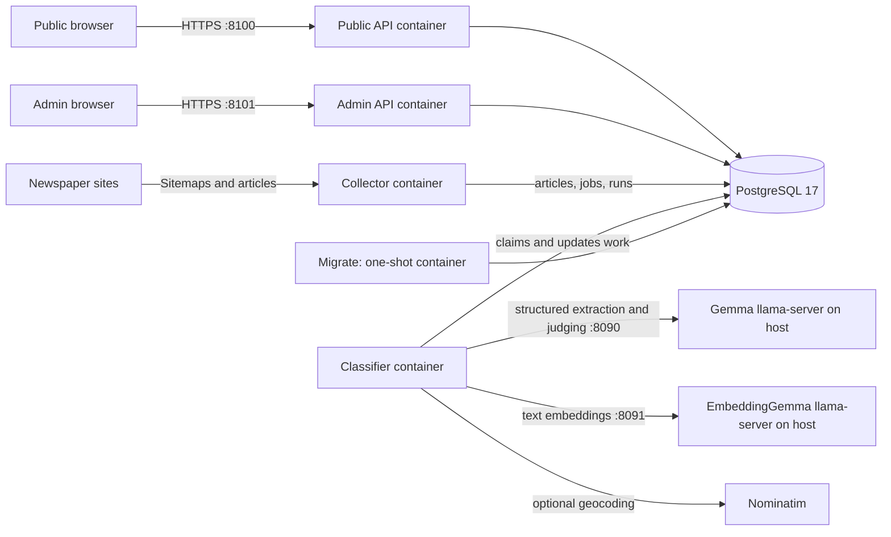

# Bangladesh Crime Map: architecture and operations

This guide describes the service boundaries, network entry points, data model and processing flow of the in-house deployment. It reflects the application inspected on 28 October 2026, updated on 29 October 2026 for all 64 districts. The deployed configuration and runtime state should be checked again before a production release.

## 1. Entry points and architecture

The public entry point is a FastAPI service on port **8100**. It serves the public map and read API. A separate FastAPI application on port **8101** provides the authenticated admin console. The inspected Docker Compose deployment does not contain a separate shared API gateway or reverse proxy. A future gateway or ingress could be added, but is not assumed here.



On the inspected host, the public and admin ports bind to `192.168.1.200`; PostgreSQL is exposed on `127.0.0.1:55432` for the host-networked classifier. The two llama.cpp services listen on host loopback at ports `8090` and `8091`. Actual binding and reachability depend on the deployment configuration and network.

## 2. Services and responsibilities

| Component | Runtime | Responsibility |
| --- | --- | --- |
| `api` | Docker | Public static map, safe incident summaries, statistics and version endpoint. |
| `admin` | Docker | Login, status, coverage, review, collection requests, event corrections, preview and Swagger. |
| `collector` | Docker | Schedule and manual requests; discover, filter and fetch newspaper articles; create jobs. |
| `classifier` | Docker, host networking | Claim work, call models, validate and save incidents, match events and enrich locations. |
| `db` | PostgreSQL 17 container | Persistent data, queues, locks, sessions and operational state. |
| `migrate` | One-shot container | Apply numbered SQL migrations, then exit. |
| `dhaka-llm` | Host user-level systemd | llama.cpp with Gemma 4 E2B Q8 for incident extraction and match judging. |
| `dhaka-embed` | Host user-level systemd | llama.cpp with text-only EmbeddingGemma 2 Q8 for report similarity. |

The application containers use the same image with different commands. PostgreSQL persists data in a named Docker volume. Classifier host networking shares the host network namespace; it enables access to model services on `127.0.0.1`, but also changes the container's network isolation. See [Docker's host-network documentation](https://docs.docker.com/engine/network/drivers/host/).

## 3. Processing flow

1. **Schedule or request:** the collector normally runs at 08:00 and 20:00 in Asia/Dhaka. Admins can request collection or a historical backfill.
2. **Discover and fetch:** publisher-specific sitemaps, URL and title signals and full-text checks select candidate stories. Robots policies and rate limits are applied. A filter can miss relevant news.
3. **Enqueue:** articles are stored and qualifying articles receive a row in `jobs`. Fresh work has higher priority than backfills.
4. **Extract:** a classifier worker claims a job with a lease, records a model call, asks in-house Gemma for structured output and saves the analysis.
5. **Validate and publish:** Python checks the evidence quote and location against the article. In automatic mode, reports passing the checks can publish without human review. Invalid incident dates can fall back to the publication or fetch date.
6. **Group reports:** the event matcher narrows candidate events by district, compatible category, place and date; embeddings rank candidates; Gemma judges the strongest candidates using distinctive shared facts and source quotes.
7. **Serve:** the public API serves event representatives, summaries and counts; the browser watches the data revision and refreshes its data when it changes.

A date filter only queries data already collected. It does not itself collect the requested historical period. Coverage, publisher availability, model quality and filter logic affect completeness.

## 4. Queues and delivery guarantees

There is **no separate Redis, RabbitMQ or Kafka service** in the inspected deployment. PostgreSQL acts as the queue store and coordination layer:

- `jobs` holds classification work, state, priorities, attempts, owner, lease and generation.
- `match_queue` holds reports waiting for event matching.
- `run_requests` holds manual collection requests; `schedule_slots` tracks scheduled runs.
- `previews` holds admin article-preview work.

Workers use short claim transactions and `FOR UPDATE SKIP LOCKED` so concurrent workers do not claim the same available row. A lease allows recovery when a worker dies, while generation and version checks prevent stale workers from publishing older results. Saved analyses can be reused after some downstream failures.

A lease and retry mechanism does **not** guarantee that a model is called exactly once in every failure scenario. The useful goal is safe recovery and preventing stale results from replacing newer ones. The database stores and coordinates work; the Python processes perform it.

## 5. Data model and duplicate matching

| Table group | Purpose |
| --- | --- |
| `articles`, `jobs` | Article URLs, bodies and work to process them. |
| `llm_calls`, `analyses`, `incidents` | Classification-call records, saved JSON and extracted reports with validation and review fields. |
| `events`, `event_reports` | One event representative and the associated report memberships. |
| `match_queue`, `match_decisions`, `event_exclusions`, `report_vectors` | Pending matching work, decision audit, admin split constraints and cached embeddings. |
| `runs`, `run_requests`, `schedule_slots`, `coverage_days`, `coverage_urls` | Collection operations and coverage tracking. |
| `admin_users`, `admin_sessions`, `admin_login_failures`, `admin_audit` | Admin authentication and operational audit data. |
| `data_revision` | Version counter used by the public page to detect changes. |

One article may describe multiple incidents. Multiple articles can report the same event. The `event_reports` table links each reduced report to an event; the earliest-published current report is selected as the primary. The public API uses that primary report as its representative. It returns a primary source URL and an additional-report count; the admin event detail can show linked reports.

Embedding similarity is only a candidate-ranking signal, not the final merge decision. The judge compares reports in both orders and requires at least two distinctive, grounded shared facts on each pass. A matching failure or unresolved ambiguity keeps reports separate; a failed matching operation is retried. An admin can split or merge groups. Same location alone does not prove that two crimes are the same event, and model decisions still require evaluation for false merges and missed duplicates.

The current category configuration marks sexual violence as mapped. The code supports a totals-only visibility mode, but no category was configured that way in the deployment inspected on 28 October 2026.

## 6. APIs and access boundaries

Public examples:

- `GET /api/config` — categories, the 8 divisions and 64 districts (with map bounds), thanas/upazilas and public configuration.
- `GET /api/incidents` — filtered published summaries and source information.
- `GET /api/stats` — counts for the same filters, including `by_division`, `by_district` and `by_thana`.
- `GET /api/version` — visible data revision.
- `GET /api/health` — basic API/database health and the build `version` (git commit).

Filters shared by `/api/incidents` and `/api/stats`: `days` or `start`/`end`, `categories`, `division`, `district`,
`thana`. An unknown value, or a district outside the given division, is an error (400), never a silently wider query.

Admin examples require appropriate authorization:

- `GET /api/meta`, `/api/runs`, `/api/coverage` — operational state.
- `POST /api/scrape` — enqueue a collection request.
- `GET /api/review/queue` and `POST /api/review/incidents/{id}` — inspect and correct incidents.
- `GET /api/events/status`, `/api/events/decisions`, `/api/events/{id}` — inspect event matching.
- `POST /api/events/split`, `/api/events/merge` — record corrections.
- `POST /api/classify`, `GET /api/classify/{id}` — run and inspect a preview. A preview does not publish an incident, but does create a preview record and consumes model capacity.

Admin passwords are stored as Argon2id hashes. The server uses session cookies, CSRF checks for browser mutations, login throttling and an audit trail. Public users do not receive database credentials. Their access is restricted by the public API's implemented routes and queries.

**Observed limitation:** the inspected containers use the same `dcm` database account, and that account was a PostgreSQL superuser. Separate least-privilege database roles are a recommended production improvement; application-level authorization alone does not restrict a compromised service's database credentials. PostgreSQL explains superuser privileges in its [role-attribute documentation](https://www.postgresql.org/docs/17/role-attributes.html).

The in-house API endpoints used a self-signed TLS certificate when inspected. Public deployment requires an appropriate certificate and a deliberate ingress, access and exposure design. TLS protects transport when correctly configured; it does not decide application permissions. See the [OWASP TLS guidance](https://cheatsheetseries.owasp.org/cheatsheets/Transport_Layer_Security_Cheat_Sheet.html).

## 7. Operations and verification

Useful **read-only** checks on the in-house server:

```bash
cd ~/dhaka-crime-map

git status --short --branch
docker compose -f compose.yaml -f compose.inhouse.yaml ps
systemctl --user status dhaka-llm dhaka-embed --no-pager
systemctl --user list-timers --all --no-pager
```

The admin console provides run history, queues and coverage without sharing database credentials. When a new article does not appear, follow it through article status, job, saved analysis, validation, event membership and the public filters. A scheduled collection can be interrupted by a service restart; collector recovery can retry interrupted work, but operators should verify the resulting run.

On 28 October 2026, the full test suite passed **115 tests** against a temporary, isolated PostgreSQL container. PR #1 had no reported automated GitHub checks. A local test pass and healthy endpoints are evidence about a particular revision and time; they are not proof of complete data coverage, semantic matching accuracy or production readiness.

Before a public release, validate deployment-specific ingress and TLS, database permissions, monitoring and alerting, backup restoration, newspaper terms and representative false-merge and missed-duplicate cases.

## 8. Geography: 8 divisions, 64 districts

The map covers all of Bangladesh. `data/places.json` is generated by `scripts/build_places.py` from committed
snapshots, so a build never needs the network:

| Source (in `data/sources/`) | Used for |
| --- | --- |
| `bdgov-admin-2026-10-29.json` — Bangladesh National Portal (bangladesh.gov.bd) division, district and upazila lists | Which divisions, districts and upazilas exist, and where each belongs (official list: 8 / 64 / 500) |
| Cabinet Division NICAR notification of 8 Jul 2026 (in the build script) | Upazilas created after the portal list (Bangra, Fatikchhari North) |
| `wikidata-bd-admin-2026-10-26.json` (CC0) | Coordinates, English names, city police thanas |
| `osm-points-2026-10-29.json` (OpenStreetMap Nominatim) | Coordinates for the few places Wikidata lacks |
| `common-word-places-2026-10-29.json` | Place names that are mostly ordinary words or person names in the news (তালা, পলাশ...), measured on the stored articles; they count only with their district in the text |
| `../dhaka_places.json`, `metro-thanas.json` | Curated Dhaka neighbourhoods and landmarks; metropolitan police thanas |

Proposed new divisions (Faridpur, Cumilla) are not in the list until they are gazetted. To update the geography:
refresh the snapshot files, run `make places`, run the tests, then migrate nothing (districts are validated by the
application; `migrations/016_all_districts.sql` removed the old six-district database check).

Place names shared by several districts (Kotwali, Mirpur, Kaliganj...) are resolved by the district named before them
or elsewhere in the text, and dropped when still ambiguous. The public page filters by division, then district; the
hotspot list ranks divisions, then the division's districts, then the district's thanas and upazilas.

### Public map design (29 Oct 2026, owner decisions after two Codex council rounds)

- **One colour-blended heat at every zoom.** Crime types blend in OKLab, chroma-preserving, so mixes stay vivid.
  District bubbles were tried and removed (owner): a bubble's single mixed colour could look like another crime
  type, while the heat shows the overlap itself.
- **Country view stays readable.** Dhaka has hundreds of times the reports of a typical district, so the strength
  scale is logarithmic when zoomed out (a lone report pale, Dhaka deep) and square-root when zoomed in (blended
  between zoom 8 and 10). The glow never gets smaller than 11 px.
- **Tap for reports.** Zoomed out, a tap opens the district under the finger: exact counts per crime type in the
  card, and its reports in the Reports panel. Zoomed in, a tap lists the reports around that spot.
- **Colours**: nine high-contrast category colours in `app/schema.py`, checked for colour-vision deficiencies
  (CIEDE2000 under normal vision and Machado-simulated protan/deutan/tritan).
- **Basemap**: OpenFreeMap's Positron vector style (no key, OpenStreetMap data) drawn by MapLibre GL 6.14. Area
  colours are removed (parks, land cover, buildings, road surfaces; water is a neutral light grey). Road lines,
  road, river and place names stay, plus every district's name when zoomed out. The heat is a raster layer *under*
  the labels, so names stay readable. If the vector map cannot load, the page falls back to OpenStreetMap raster
  tiles (`#base=tiles` forces this for testing). Check OpenFreeMap's and OSM's usage terms before a high-traffic
  public launch, or self-host the tiles.
- **District-level reports**: an incident whose text names its district but no catalogued place is published at
  district level (counted in the district's totals and Reports; no heat point), and the event matcher deduplicates
  it within the district.

## 9. Build, release and deployment (CI/CD handoff)

One image serves every role; the command picks it (`api`, `admin`, `collector`, `classifier`, `migrate`). The
`Makefile` holds the commands a pipeline needs:

| Stage | Command | Needs |
| --- | --- | --- |
| Build | `make build` (tags `dhaka-crime-map:<git sha>` and `:latest`; `/api/health` reports the sha) | Docker |
| Unit tests | `make test-unit` (no network, no database) | Docker |
| Full tests | `make test` (runs against a `dcm_test` database in the compose Postgres) | `.env` with `POSTGRES_PASSWORD` |
| Migrate | `make migrate` — numbered SQL files in `migrations/`, applied once each, in order, forward-only | database |
| Deploy | `make deploy` = migrate, `up -d --build`, then `make smoke` | the server |
| Smoke test | `make smoke` — container health, `/api/health`, collector and classifier heartbeats, `events-verify` | running stack |

Health checks: `api` and `admin` call `/api/health`; `collector` and `classifier` run
`python -m app healthcheck <service>`, which fails when the service's database heartbeat is older than 15 or 5 minutes.

**Configuration** comes from `.env` (template: `.env.example`, never committed). Secrets: `POSTGRES_PASSWORD`,
`ADMIN_TOKEN`, `GEMMA_API_KEY` (must equal the model server's key file `~/.config/dhaka-llm/api-key`),
`GOOGLE_MAPS_API_KEY` (optional, browser key), the TLS key in `deploy/tls/`. A pipeline should inject these from its
secret store; they must never be baked into the image (the Dockerfile copies only `app/`, `migrations/` and
`data/places.json`).

**Host dependencies outside Docker** (install once per GPU host, see `deploy/inhouse-llm/`): `dhaka-llm` (llama.cpp,
Gemma 4 E2B, port 8090; parallel slots via the drop-in `deploy/inhouse-llm/dhaka-llm-parallel.conf`: `DHAKA_LLM_PARALLEL=4`, `DHAKA_LLM_CTX=49152` = 12K tokens per slot on the 12 GB in-house GPU) and `dhaka-embed` (EmbeddingGemma 2, port 8091) as systemd user services
with lingering enabled. The classifier uses host networking to reach them on loopback.

**Ports:** public 8100 and admin 8101 (HTTPS; bind addresses `API_BIND`, `ADMIN_BIND`), Postgres on loopback 55432
for the classifier only. Admin must stay on the office LAN/VPN.

**Rollback:** redeploy the previous image tag. Migrations are additive and forward-only; a release whose migration
cannot be undone safely says so in its pull request. Take a database backup (`deploy/backup-db.sh`) before migrating.

**Data changes that need a re-run** (for example a wider geography or a new prompt) are separate operator steps, not
part of the deploy: `reprocess-all --yes` (every stored article through Gemma again), `refilter-skipped --days N`
(re-check skipped articles with today's pre-filter), `collect-now --days N` (fetch missed days). The event store
updates itself afterwards; check with `events-verify`.

## 10. Code map

- Service configuration: [`compose.yaml`](../compose.yaml), [`compose.inhouse.yaml`](../compose.inhouse.yaml), [`Dockerfile`](../Dockerfile).
- Public and admin APIs: [`app/public.py`](../app/public.py), [`app/api.py`](../app/api.py), [`app/auth.py`](../app/auth.py).
- Collection and scheduling: [`app/collector.py`](../app/collector.py), [`app/scraper.py`](../app/scraper.py), [`app/scheduler.py`](../app/scheduler.py), [`app/sources.py`](../app/sources.py).
- Model processing and events: [`app/worker.py`](../app/worker.py), [`app/store.py`](../app/store.py), [`app/events.py`](../app/events.py).
- Database and schema: [`app/db.py`](../app/db.py), [`migrations/`](../migrations/).
- Geography: [`scripts/build_places.py`](../scripts/build_places.py), [`data/places.json`](../data/places.json), [`app/gazetteer.py`](../app/gazetteer.py).
- Build and release: [`Makefile`](../Makefile), [`.env.example`](../.env.example).
- Host model services: [`deploy/inhouse-llm/`](../deploy/inhouse-llm/).
